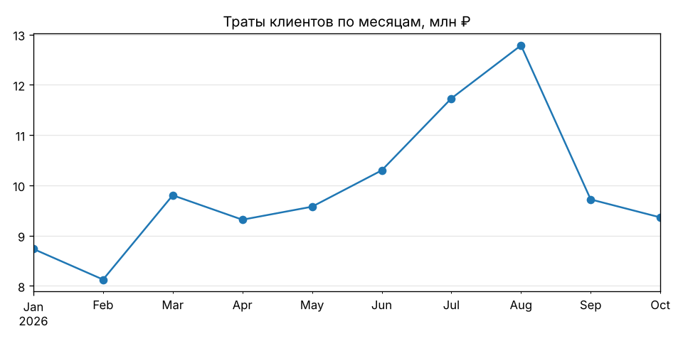

# B2C Analytics Practice

Практика SQL, pandas и Excel на синтетических данных розничного банка: клиенты, операции по картам и показы персональных предложений в приложении.

Задачи повторяют то, чем занимается аналитик в B2C: траты по сегментам и категориям, динамика по месяцам, CTR предложений, отчёт за месяц одной функцией.

## Данные

Данные **синтетические**: их создаёт скрипт [`generate_db.py`](generate_db.py) из генератора случайных чисел с фиксированным seed. Реальных клиентов здесь нет. В данные заложены правдоподобные закономерности, которые потом находятся запросами.

| Таблица | Строк | Столбцы |
|---|---:|---|
| `clients` | 2 000 | `client_id`, `gender`, `age`, `city`, `segment`, `has_sberprime`, `reg_date` |
| `transactions` | 31 693 | `txn_id`, `client_id`, `txn_date`, `category`, `amount`, `channel` |
| `offers` | 8 069 | `show_id`, `client_id`, `shown_date`, `offer`, `clicked`, `converted` |

Период: январь–октябрь 2026. Сегменты: массовый, массовый высокодоходный, премиум.

## Что внутри

```
generate_db.py        создаёт базу b2c.db (SQLite)
sql/tasks.sql         12 задач на SQL с решениями: от GROUP BY до оконных функций
pandas_tasks.py       5 задач на pandas без решений
pandas_solutions.py   решения: read_sql, groupby, merge, pivot_table, график, отчёт за месяц
build_excel.py        собирает practice.xlsx: данные и задания на сводные, ВПР, СУММЕСЛИМН
```

## Как запустить

```bash
pip install -r requirements.txt
python generate_db.py        # создаст b2c.db
python pandas_solutions.py   # посчитает метрики, сохранит график и monthly_report.xlsx
python build_excel.py        # соберёт practice.xlsx
```

SQL-задачи удобно решать в DBeaver или DataGrip: подключение SQLite → файл `b2c.db`.

## Что получилось на данных



- **Сезонность.** Пик трат — август, 12,8 млн ₽. В сентябре траты падают на 24%, и 93% этого падения дают путешествия: сезон отпусков закончился.
- **Сегменты.** Средний чек премиум-клиента 6 573 ₽, в 3,3 раза выше, чем у массового (2 016 ₽).
- **Предложения.** Лучший CTR у кешбэка на маркетплейсах (16,3%), хуже всего у кредитной карты (5,2%). Предложения, связанные с тем, на что клиент и так тратит, кликают заметно чаще.
- **СберПрайм.** У подписчиков CTR выше: 13,8% против 10,8%.

## Темы

**SQL:** `GROUP BY` и `HAVING`, `JOIN` и анти-джойн через `LEFT JOIN … IS NULL`, CTE, `CASE WHEN`, даты, оконные функции `RANK`, `SUM() OVER`, `LAG`.

**pandas:** `read_sql`, `groupby` и `agg`, `merge`, `pivot_table`, работа с датами, графики matplotlib, выгрузка отчёта в Excel.

---

Генератор данных и набор задач подготовлены с помощью AI-ассистента (Claude).
